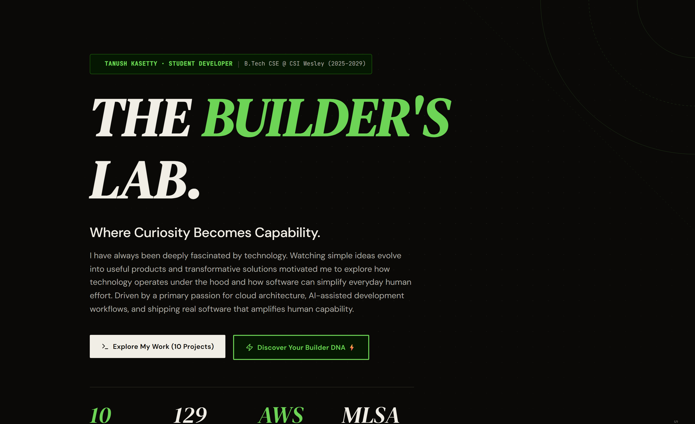
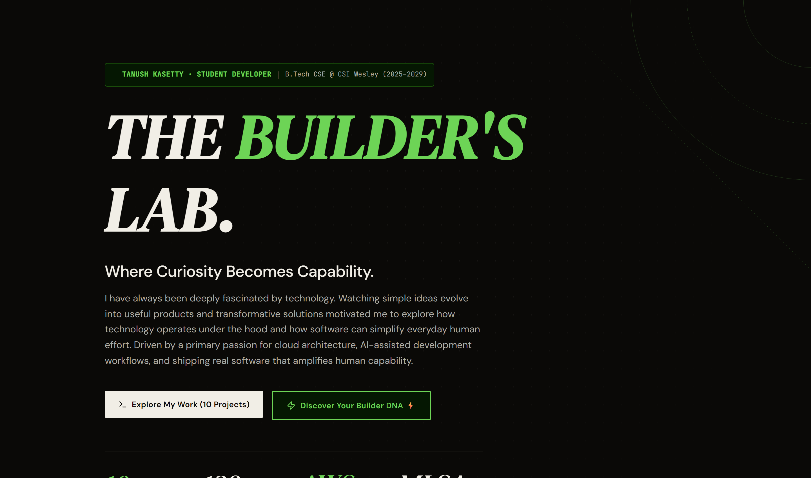
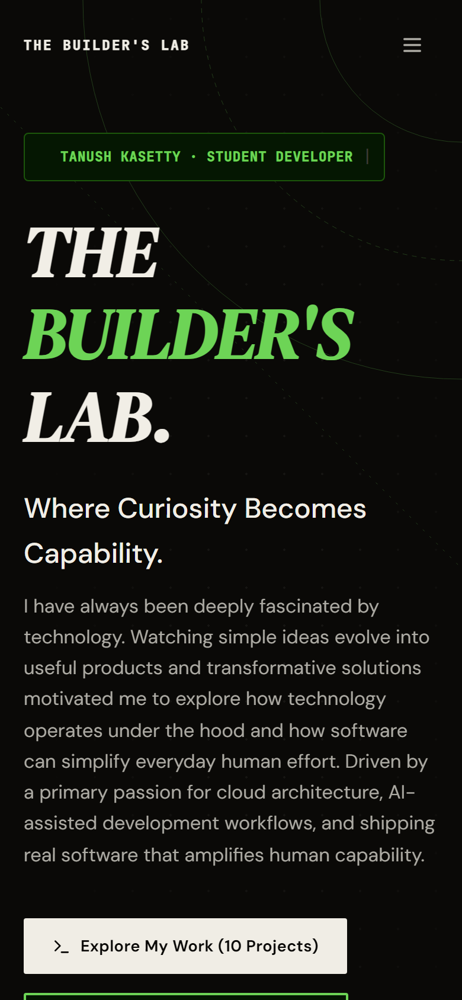
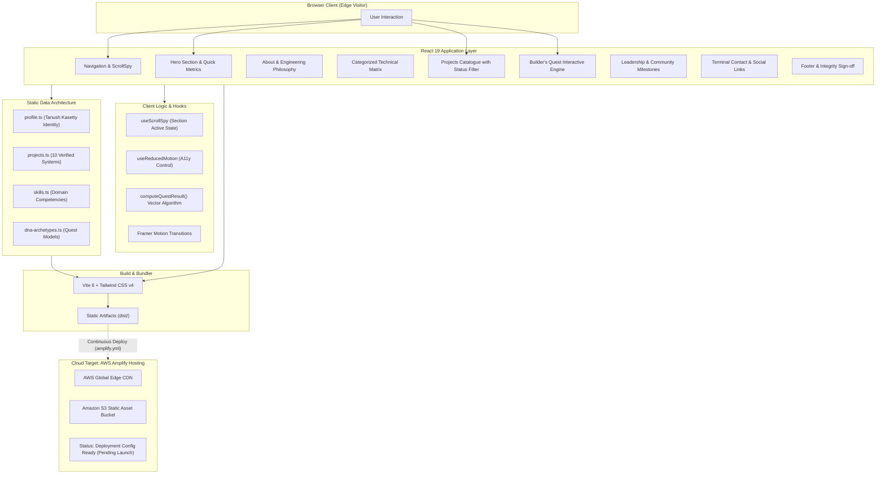
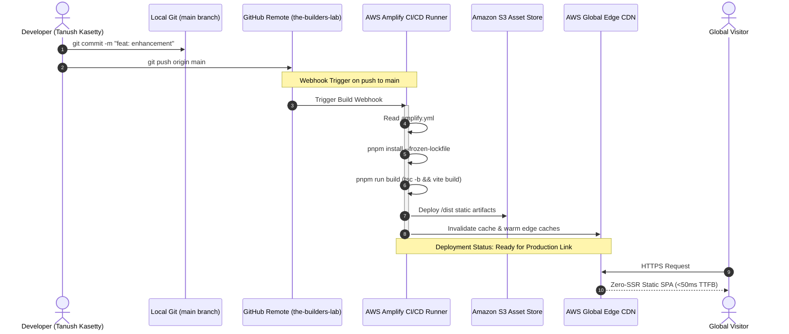
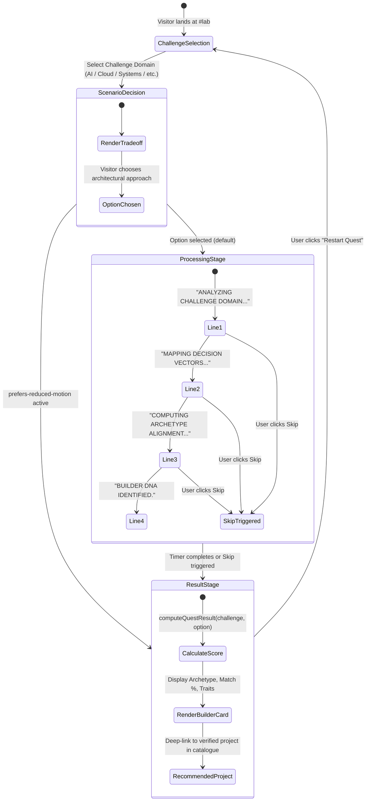

# THE BUILDER'S LAB ✦

<div align="center">

```
  ┌────────────────────────────────────────────────────────────────────────┐
  │                                                                        │
  │   ████████╗██╗  ██╗███████╗    ██████╗ ██╗   ██╗██╗██╗     ██████╗     │
  │   ╚══██╔══╝██║  ██║██╔════╝    ██╔══██╗██║   ██║██║██║     ██╔══██╗    │
  │      ██║   ███████║█████╗      ██████╔╝██║   ██║██║██║     ██║  ██║    │
  │      ██║   ██╔══██║██╔══╝      ██╔══██╗██║   ██║██║██║     ██║  ██║    │
  │      ██║   ██║  ██║███████╗    ██████╔╝╚██████╔╝██║███████╗██████╔╝    │
  │      ╚═╝   ╚═╝  ╚═╝╚══════╝    ╚═════╝  ╚═════╝ ╚═╝╚══════╝╚═════╝     │
  │                                                                        │
  │                      L  A  B  O  R  A  T  O  R  Y                      │
  └────────────────────────────────────────────────────────────────────────┘
```

**Where Curiosity Becomes Capability.**

*A digital laboratory, systems portfolio, and interactive discovery engine engineered by **Tanush Kasetty**.*  
*Crafted for the **AWS Student Builder Challenge 2026**.*

[](https://react.dev/)
[](https://www.typescriptlang.org/)
[](https://vitejs.dev/)
[](https://tailwindcss.com/)
[](https://aws.amazon.com/amplify/)
[](LICENSE)

[Live Demonstration Pending](#-cloud-architecture--aws-amplify-deployment) · [Explore Projects](#-shipped-systems-catalogue) · [Interactive Builder's Quest](#-signature-feature-builders-quest) · [System Architecture](#-system-architecture)

</div>

---

## 📑 Table of Contents

- [🏛️ Executive Overview](#️-executive-overview)
- [🖼️ Visual Gallery](#️-visual-gallery)
- [⚡ Signature Feature: Builder's Quest](#-signature-feature-builders-quest)
- [🏗️ System Architecture](#️-system-architecture)
  - [A. Application Layer Topology](#a-application-layer-topology)
  - [B. Continuous Integration & AWS Amplify Pipeline](#b-continuous-integration--aws-amplify-pipeline)
  - [C. Quest Algorithmic State Engine](#c-quest-algorithmic-state-engine)
- [🧪 Shipped Systems Catalogue](#-shipped-systems-catalogue)
- [🛠️ Engineering Disciplines & Technology Stack](#️-engineering-disciplines--technology-stack)
- [☁️ Cloud Architecture & AWS Amplify Deployment](#️-cloud-architecture--aws-amplify-deployment)
- [💻 Local Installation & Build Commands](#-local-installation--build-commands)
- [🎖️ Academic Foundation & Verified Badges](#️-academic-foundation--verified-badges)
- [📬 Developer Information](#-developer-information)

---

## 🏛️ Executive Overview

**THE BUILDER'S LAB** is an original developer portfolio and software exhibition space engineered for the **AWS Student Builder Challenge 2026**. 

Rejecting generic portfolio tropes—such as neon glow cards, excessive glassmorphic blur, and repetitive AI boilerplate—the application treats portfolio presentation as an **editorial digital laboratory**. Built with a strict palette of dark graphite (`#121417`), warm ivory (`#F5F2EB`), and phosphor-green telemetry accents (`#22C55E`), it showcases:

1. **Ten Verified Standalone Systems:** Production applications spanning full-stack web, generative AI orchestration, legal contract intelligence, computer vision telemetry, and terminal-native C utilities.
2. **Deterministic Interactive Feature:** *Builder's Quest*—a multi-stage decision engine that evaluates visitors' engineering preferences, computes a Developer DNA archetype, and maps them directly to corresponding source code in the catalogue.
3. **Verified Quality Standards:** Strict TypeScript compilation (`tsc -b`), automated test coverage across systems (including 97 tests on ClauseLens and 32 tests on CarbonTrack, totaling 129 documented tests), full keyboard navigation, and WCAG AA contrast compliance.
4. **Cloud-Native Deployment Specification:** Pre-configured with [`amplify.yml`](./amplify.yml) for automated static hosting and edge CDN caching on AWS Amplify Hosting.

---

## 🖼️ Visual Gallery

Every screenshot below is an authentic, full-resolution capture captured directly from the running application instance.

### 1. Landing Experience & Laboratory Header
The landing viewport introduces the digital laboratory metaphor, displaying real-time system metrics, direct CTA routing to the Builder's Quest, and an overview of current technical disciplines.


---

### 2. Personal Story & Editorial Narrative
A structured narrative detailing Tanush's background, education at CSI Wesley Institute of Technology and Science (Hyderabad), and core engineering values.


---

### 3. Core Competencies & Skills Architecture
Grouped by domain (Languages, Frontend, Backend & Autonomous Agents, Cloud & Systems), featuring concrete real-world context for each skill.


---

### 4. Shipped Projects Catalogue
A dual-tier catalogue with status-filtered views distinguishing verified live deployments from local setups and CLI utilities.


---

### 5. Signature Interactive Lab: Builder's Quest
An accessible, interactive decision engine. The initial screen allows visitors to select a problem space (AI, Cloud, Systems, Interfaces, Data).



---

### 6. Builder DNA Result Card
Upon navigating the decision scenario, the engine calculates a personalized Developer DNA profile, matching percentage, traits, and recommended project.


---

### 7. Leadership, Community & Recognition
Highlighting hackathon milestones (Murf AI Voice Agent Challenge), Microsoft Learn Student Ambassador pathway criteria, and academic diplomas.


---

### 8. Digital Presence & Contact
Terminal-inspired contact terminal providing verified links to GitHub, LinkedIn, DEV Community, GeeksforGeeks, and AWS Builder Center.



---

### 9. Mobile Responsive Layout
Fluid layout adapting seamlessly to narrow viewports without compromising typography, hierarchy, or interactive capability.

<div align="center">
  
</div>

---

## ⚡ Signature Feature: Builder's Quest

Situated at `#lab` (with direct calls-to-action in the hero section and navigation bar), **Builder's Quest** is an interactive laboratory instrument that personalizes the visitor experience.

```
┌────────────────────────────────────────────────────────────────────────┐
│ STAGE 1: Choose Domain     ──>  AI, Cloud, Systems, Product, Data     │
│ STAGE 2: Decision Vector   ──>  Scenario-based architecture tradeoff   │
│ STAGE 3: Alignment Compute ──>  Telemetry synthesis (skipping allowed) │
│ STAGE 4: Reveal DNA Card   ──>  Archetype, traits, & project match    │
└────────────────────────────────────────────────────────────────────────┘
```

### Engineering Highlights of the Quest
- **Zero Latency & 100% Deterministic:** Runs client-side using typed algorithmic scoring in [`src/data/dna-archetypes.ts`](./src/data/dna-archetypes.ts). No external API dependencies or hidden paywalls.
- **Accessibility First:** Full keyboard control (`Tab`, `Space`, `Enter`), semantic radio groups, explicit `aria-live="polite"` feedback, and high-contrast focus rings.
- **Motion Sensitivity:** Evaluates `prefers-reduced-motion` via a custom React hook ([`useReducedMotion.ts`](./src/lib/useReducedMotion.ts)) to immediately bypass processing animations.
- **Interactive Restart:** Single-click memory reset allowing instant re-evaluation across different challenge disciplines.

---

## 🏗️ System Architecture

### A. Application Layer Topology
The diagram below details the client-side module hierarchy, data boundaries, and the static delivery target on AWS.



---

### B. Continuous Integration & AWS Amplify Pipeline
How code moves from local development to the AWS Amplify global edge network.



---

### C. Quest Algorithmic State Engine
State transition and deterministic vector calculation behind the Builder's Quest.



---

## 🧪 Shipped Systems Catalogue

Ten genuine, independently developed applications representing full-stack architectures, systems programming, and cloud integrations:

| # | Project Name | Primary Domain | Core Stack | Documented Tests | Deployment Status | Source Repository |
|---|---|---|---|:---:|---|:---:|
| 01 | **ProductivityOS AI** | GenAI Workspace & Autopilot | Next.js 16, React 19, Tailwind v4, Groq SDK, Gemini | — | 🟢 **Live on AWS Amplify** | [GitHub ↗](https://github.com/tanush326k/ProductivityOS-AI) |
| 02 | **PulseOps** | AI Incident Commander | Python, FastAPI, Strands Agents SDK, boto3, Bedrock | — | 🟡 **Local Setup** *(Optional AWS Bedrock via boto3)* | [GitHub ↗](https://github.com/tanush326k/PulseOps) |
| 03 | **ClauseLens** | Legal Contract Intelligence | Next.js 15, React 19, Gemini Flash, Zod, Vitest | **97 Tests** | 🟢 **Live on Render** | [GitHub ↗](https://github.com/tanush326k/ClauseLens) |
| 04 | **Planora AI** | Event Planning Engine | Next.js 16, React 19, Tailwind v4, Gemini 2.5, Zod | — | 🟢 **Live on Vercel** | [GitHub ↗](https://github.com/tanush326k/Planora-AI) |
| 05 | **MatchOps AI** | Smart Stadium Operations | React 19, Vite, FastAPI, Python, Docker, Recharts | — | 🟢 **Live on Render** | [GitHub ↗](https://github.com/tanush326k/matchops-ai) |
| 06 | **CarbonTrack** | Carbon Footprint Analytics | Python, FastAPI, JavaScript, Docker, SQLite, Pytest | **32 Tests** | 🟢 **Live on Google Cloud Run** | [GitHub ↗](https://github.com/tanush326k/carbontrack) |
| 07 | **Smart Notes** | Semantic AI Notebook | Vite, React 19, Tailwind v4, Framer Motion, Gemini | — | 🟢 **Live on Vercel** | [GitHub ↗](https://github.com/tanush326k/Smart-Notes) |
| 08 | **Election Guide** | Civic Education Simulator | HTML5, CSS3, JavaScript, Docker Containerization | — | 🟡 **Local / Docker Container** | [GitHub ↗](https://github.com/tanush326k/Election-Guide) |
| 09 | **Daily Routine Analyser** | Productivity Pattern Analyzer | C, Terminal Standard Library, CLI | — | 🟡 **Local CLI Project** | [GitHub ↗](https://github.com/tanush326k/daily-routine-analyser) |
| 10 | **Hermes Agent Assistant** | Autonomous Agent Engine | Python, FastAPI, Uvicorn, Pydantic v2 | — | 🟡 **Local Setup Required** | [GitHub ↗](https://github.com/tanush326k/hermes-agent-assistant) |

> **Documented Automated Test Total:** Exactly **129 passing automated tests** (97 on ClauseLens + 32 on CarbonTrack).  
> **Challenge Experiment Note:** *MoneyBuddy* was an AI voice agent prototype built during the Murf AI 10 Days of Voice Agents Challenge across project branches and is documented as a hackathon experiment rather than an eleventh standalone project card.

---

## 🛠️ Engineering Disciplines & Technology Stack

```
Languages & Foundations
  ├── TypeScript 5.7        Type-safe domain logic and strict interface contracts
  ├── JavaScript (ESNext)   Modern ECMAScript runtime execution
  ├── Python 3.11+          FastAPI backends, agents orchestration, and data analysis
  ├── C (ANSI/C99)          Low-level memory-conscious CLI systems utilities
  ├── HTML5 & CSS3          Semantic markup and modern layout architectures
  └── SQL (SQLite / PG)     Relational schema design and data modeling

Frontend Architecture & Creative Engineering
  ├── React 19              Component lifecycle and modern UI composition
  ├── Vite 6                High-velocity development server and optimized Rollup bundler
  ├── Tailwind CSS v4       Oxide engine, CSS-first design tokens, OKLCH color spaces
  ├── Framer Motion         Coordinated spatial animations and responsive layout springs
  └── Lucide Icons          Crisp, lightweight SVG iconography

Cloud, DevOps & Production Delivery
  ├── AWS Amplify Hosting   Git-triggered continuous deployment and global edge distribution
  ├── AWS SDK (boto3)       Python cloud integration (Amazon Bedrock in PulseOps)
  ├── Docker                Containerized reproducible runtimes and services
  └── Google Cloud Run      Containerized microservice deployments (CarbonTrack)

Testing & Code Quality
  ├── Vitest                High-speed unit and component testing
  ├── Pytest                Python API and logic verification suites
  ├── Zod                   Runtime schema validation and type inference
  └── ESLint 9              Linting and static code analysis
```

---

## ☁️ Cloud Architecture & AWS Amplify Deployment

This portfolio is configured for zero-SSR static distribution via **AWS Amplify Hosting**. The deployment specification is version-controlled in [`amplify.yml`](./amplify.yml):

```yaml
version: 1
frontend:
  phases:
    preBuild:
      commands:
        - corepack enable
        - corepack prepare pnpm@latest --activate
        - pnpm install --frozen-lockfile
    build:
      commands:
        - pnpm run build
  artifacts:
    baseDirectory: dist
    files:
      - '**/*'
  cache:
    paths:
      - node_modules/**/*
      - $(pnpm store path)/**/*
```

### AWS Integration Points Across Tanush's Work
1. **THE BUILDER'S LAB (This Portfolio):** Ready for continuous deployment on AWS Amplify Hosting, outputting an optimized static bundle with immutable caching headers.
2. **ProductivityOS AI:** Verified and actively running on AWS Amplify Hosting with automated GitHub push hooks.
3. **PulseOps:** Implements an optional Amazon Bedrock integration through Python's `boto3` SDK to synthesize automated incident post-mortems and remediation advice.

---

## 💻 Local Installation & Build Commands

### Prerequisites
- **Node.js:** v20.12.0 or higher
- **Package Manager:** `pnpm` (recommended) or `npm`
- **Git:** Standard git client

### 1. Clone the Repository
```bash
git clone https://github.com/tanush326k/the-builders-lab.git
cd the-builders-lab
```

### 2. Install Dependencies
```bash
pnpm install
```

### 3. Run Development Server
```bash
pnpm run dev
# Starts local development server at http://localhost:5173
```

### 4. Production Build & Typecheck
```bash
pnpm run build
# Executes TypeScript compilation (tsc -b) followed by Vite production bundling
```

### 5. Local Production Preview
```bash
pnpm run preview
# Serves the compiled dist/ directory locally
```

### 6. Automated Browser Screenshot Verification
A custom headless browser automation script is included to capture high-resolution screenshots of the live build:
```bash
pnpm run screenshots
# Launches headless Chrome against a local static server, interacts with Builder's Quest,
# and updates images in docs/screenshots/
```

---

## 🎖️ Academic Foundation & Verified Badges

- **Degree:** B.Tech in Computer Science and Engineering (2025–2029)  
  *CSI Wesley Institute of Technology and Science, Hyderabad*
- **Technical Diploma:** DCAP (Diploma in Computer Applications — MS Office, Word, C, C++)
- **Murf AI Voice Agent Challenge:** Recognized during the 10 Days of Voice Agents challenge for AI voice agent engineering.
- **Microsoft Learn Student Ambassador (MLSA) Pathway Criteria:**
  - Active Technical Community Leadership
  - Documented Public Technical Workshops / Presentations
  - Verified Open Source Software Contributions
  - Advanced Cloud Skill Achievements

---

## 📬 Developer Information

<div align="center">

**Tanush Kasetty**  
*Student Developer · Software Systems Builder*

[](https://github.com/tanush326k)
[](https://www.linkedin.com/in/tanush701321/)
[](https://dev.to/tanush_326k)
[](https://www.geeksforgeeks.org/profile/tanush326k)
[](https://www.credly.com/users/tanush-kasetty)
[](https://aws.amazon.com/)

</div>

---

<div align="center">
<sub>Designed and built with precision for the <strong>AWS Student Builder Challenge 2026</strong>. All metrics and project claims are documented and independently verifiable.</sub>
</div>
