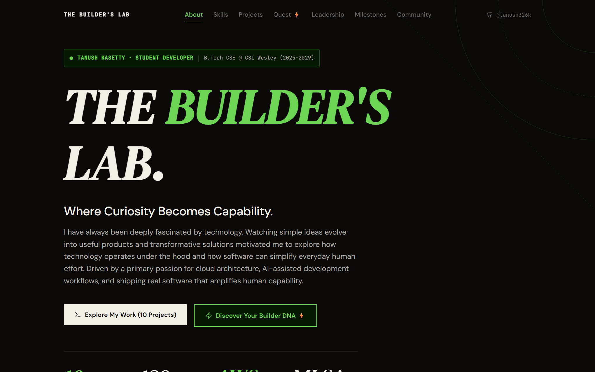
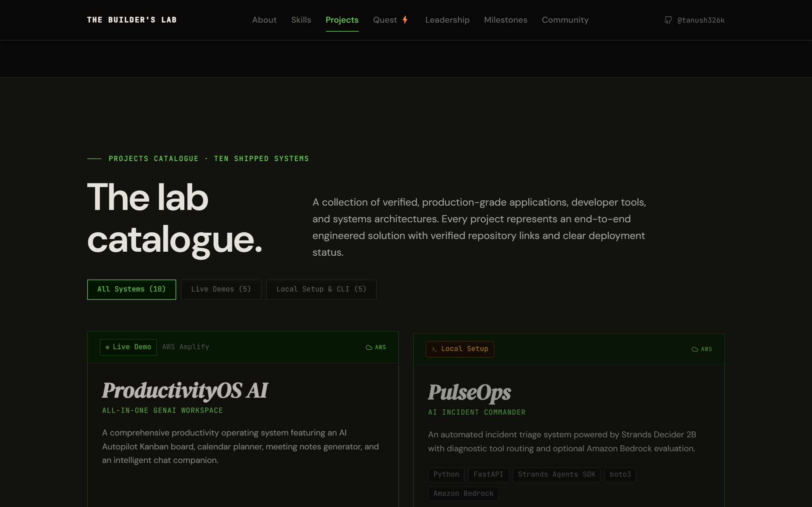
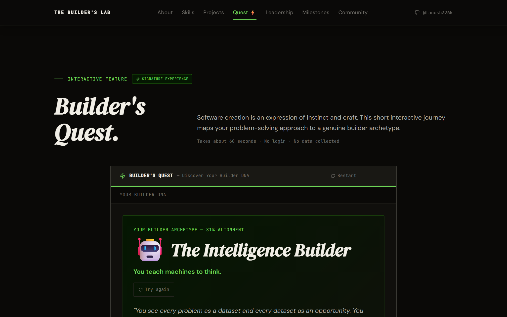
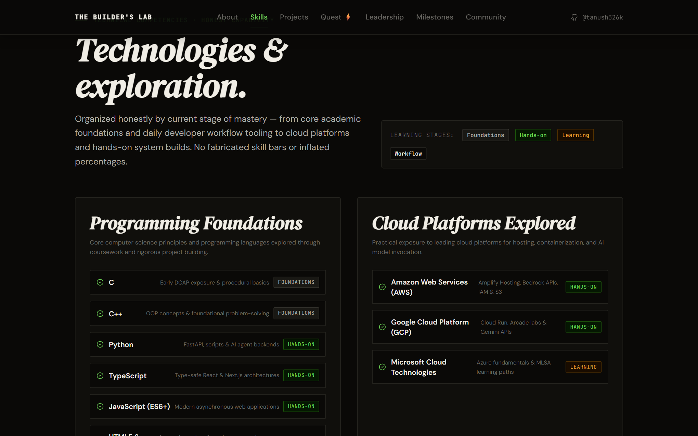
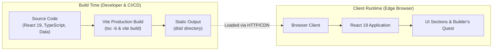
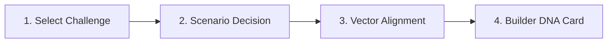

# THE BUILDER'S LAB

> **Where Curiosity Becomes Capability.**  
> An interactive digital laboratory and engineering portfolio built by **Tanush Kasetty** for the **AWS Student Builder Challenge 2026**.

[](https://react.dev/)
[](https://www.typescriptlang.org/)
[](https://vitejs.dev/)
[](https://tailwindcss.com/)
[](https://aws.amazon.com/amplify/)

---

## Overview

**THE BUILDER'S LAB** is an original developer portfolio designed as an **interactive digital laboratory**. Built with a focused aesthetic of dark graphite, warm ivory, and phosphor-green telemetry accents, it presents ten verified standalone software systems, personal engineering milestones, and a deterministic interactive feature called **Builder's Quest** that maps visitors to their developer archetype and matching projects.

---

## Visual Showcase

### 1. Hero & Command Center
The landing experience establishes the laboratory theme with system telemetry, quick metrics, and direct pathways to both the projects catalogue and the interactive Builder's Quest.



### 2. Shipped Projects Catalogue
The catalogue organizes ten standalone projects with instant status filters (All, Live Demos, Local Setup & CLI), technology tags, and direct repository links.



### 3. Builder's Quest (Archetype Result)
An interactive laboratory tool where visitors select a challenge domain and architecture tradeoff to reveal their calculated Developer DNA archetype and matching source code.



### 4. Technical Competencies Matrix
A structured matrix detailing core technical skills across Languages, Frontend Architecture, Backend & Agents, and Cloud Infrastructure.



---

## Highlights

- **Ten Verified Standalone Projects:** Spanning full-stack web platforms, generative AI tooling, legal tech, sports telemetry, and terminal C utilities.
- **129 Tests Documented Across ClauseLens and CarbonTrack:** Verified project-level test counts documented in their respective repositories (97 tests on ClauseLens, 32 tests on CarbonTrack). *Note: These are individual project test suites, not tests executed by this portfolio build.*
- **Interactive Builder's Quest:** A 4-stage decision engine that deterministically computes developer archetypes on the client side with zero API latency.
- **Accessibility & Motion Control:** Built with semantic HTML, full keyboard navigation, ARIA announcements, and reduced-motion preference detection.
- **AWS Deployment Specification:** Configured with [`amplify.yml`](./amplify.yml) for automated continuous deployment to AWS Amplify Hosting *(live deployment pending)*.

---

## Signature Feature: Builder's Quest

Situated at `#lab`, **Builder's Quest** lets visitors discover their Builder DNA through a short architectural scenario:

1. **Choose Domain:** Select a challenge area (AI, Cloud, Systems, Interfaces, Data).
2. **Make Your Move:** Choose an architectural approach to a real-world scenario.
3. **Compute Alignment:** Fast client-side vector calculation with skip animation support.
4. **Reveal Builder Card:** Displays your archetype, alignment percentage, core traits, and a matching project from Tanush's portfolio.

---

## Technology Stack

- **Frontend Core:** React 19, TypeScript 5.7, Vite 6
- **Styling & Animation:** Tailwind CSS v4 (OKLCH color system), Framer Motion, Lucide React
- **Cloud & Deployment:** AWS Amplify Hosting (`amplify.yml`), Docker
- **Testing & Quality:** Vitest, Pytest, Zod schema validation, ESLint 9

---

## System Architecture

### Application Architecture
Vite compiles and bundles source code at build time into an immutable static directory (`dist/`). When requested, the browser client loads the static bundle and initializes the React 19 application runtime.



### AWS CI/CD Deployment Workflow
The repository contains the build specification for AWS Amplify Hosting. Repository connection, webhook activation, and live distribution remain pending approval.

```mermaid
flowchart LR
    Dev["Developer"] -->|"Committed & Pushed"| GitHub["GitHub Repository<br/>(the-builders-lab)"]

    GitHub -.->|"1. Connect in Console (Pending)"| AmplifyConsole

    subgraph Pending["Pending Setup & Live Connection"]
        AmplifyConsole["AWS Amplify Console"]
        AmplifyConsole -.->|"2. Activate Webhook (Pending)"| AmplifyBuild["Amplify CI/CD Build<br/>(amplify.yml)"]
        AmplifyBuild -.->|"3. Distribute to Edge (Pending)"| AmplifyEdge["AWS Edge CDN Hosting"]
        AmplifyEdge -.->|"4. Public Availability (Pending)"| PublicLive["Live Portfolio URL"]
    end

    style Pending stroke-dasharray: 4 4
    style AmplifyConsole stroke-dasharray: 4 4
    style AmplifyBuild stroke-dasharray: 4 4
    style AmplifyEdge stroke-dasharray: 4 4
    style PublicLive stroke-dasharray: 4 4
```



### Builder's Quest Flow
A deterministic four-stage state machine evaluates visitor choices client-side.



---

## Shipped Projects

Ten software projects conceived and built with AI assistance:

| Project | Primary Domain | Stack | Verified Status | Repository |
|---|---|---|---|:---:|
| **ProductivityOS AI** | GenAI Workspace | Next.js 16, React 19, Groq SDK | 🟢 Live on AWS Amplify | [GitHub ↗](https://github.com/tanush326k/ProductivityOS-AI) |
| **PulseOps** | AI Incident Commander | Python, FastAPI, boto3, Bedrock | 🟡 Local Setup *(Optional Bedrock)* | [GitHub ↗](https://github.com/tanush326k/PulseOps) |
| **ClauseLens** | Legal Intelligence | Next.js 15, Gemini Flash, Zod | 🟢 Live on Render *(97 Tests)* | [GitHub ↗](https://github.com/tanush326k/ClauseLens) |
| **Planora AI** | Event Planning Engine | Next.js 16, Gemini 2.5, Zod | 🟢 Live on Vercel | [GitHub ↗](https://github.com/tanush326k/Planora-AI) |
| **MatchOps AI** | Smart Stadium Ops | React 19, FastAPI, Docker | 🟢 Live on Render | [GitHub ↗](https://github.com/tanush326k/matchops-ai) |
| **CarbonTrack** | Footprint Analytics | Python, FastAPI, Docker, Pytest | 🟡 Deployment URL documented — availability unverified *(32 Tests)* | [GitHub ↗](https://github.com/tanush326k/carbontrack) |
| **Smart Notes** | Semantic AI Notebook | Vite, React 19, Tailwind v4 | 🟢 Live on Vercel | [GitHub ↗](https://github.com/tanush326k/Smart-Notes) |
| **Election Guide** | Civic Education | HTML5, JavaScript, Docker | 🟡 Local / Docker Container | [GitHub ↗](https://github.com/tanush326k/Election-Guide) |
| **Daily Routine Analyser** | Routine Optimization | C, Terminal Standard Library | 🟡 Local CLI Project | [GitHub ↗](https://github.com/tanush326k/daily-routine-analyser) |
| **Hermes Agent Assistant** | Modular AI Agent Framework | Python, FastAPI, Pydantic v2 | 🟡 Local Setup Required | [GitHub ↗](https://github.com/tanush326k/hermes-agent-assistant) |

*Note: MoneyBuddy was an experimental voice agent created during the Murf AI 10 Days of Voice Agents Challenge within project branches and is documented as a hackathon experiment.*

---

## Local Setup & Development

### Prerequisites
- Node.js v20.12.0+
- pnpm (or npm)

### Quick Start
```bash
# Clone the repository
git clone https://github.com/tanush326k/the-builders-lab.git
cd the-builders-lab

# Install dependencies
pnpm install

# Start local development server
pnpm dev

# Build for production
pnpm build

# Preview production build locally
pnpm preview
```

To regenerate the documentation screenshots using headless Chrome:
```bash
pnpm run screenshots
```

---

## AWS Amplify Hosting Status

THE BUILDER'S LAB is pre-configured for automated continuous deployment on **AWS Amplify Hosting** via [`amplify.yml`](./amplify.yml):

- **Status:** **Configuration Complete — Deployment Pending** (Awaiting AWS Amplify console repository connection).
- **Build Spec:** Enables pnpm, installs dependencies with frozen lockfile, executes `tsc -b && vite build`, and distributes static artifacts from `dist/` across AWS edge locations.
- **Related AWS Projects:** Tanush's **ProductivityOS AI** is actively deployed on AWS Amplify, and **PulseOps** integrates Amazon Bedrock via Python's `boto3` SDK.

---

## Author

**Tanush Kasetty**  
*Student Developer · B.Tech Computer Science and Engineering (2025–2029)*  
*CSI Wesley Institute of Technology and Science, Hyderabad*

[](https://github.com/tanush326k)
[](https://www.linkedin.com/in/tanush701321/)
[](https://dev.to/tanush_326k)
[](https://www.geeksforgeeks.org/profile/tanush326k)
[](https://www.credly.com/users/tanush-kasetty)
[](https://aws.amazon.com/)

---

<sub>Built for the <strong>AWS Student Builder Challenge 2026</strong>. All metrics, projects, and deployment statuses are documented and verifiable.</sub>
